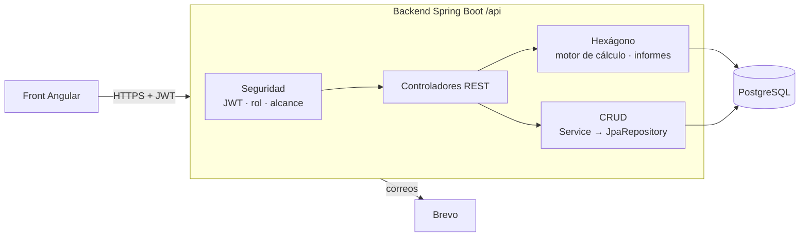

# Arquitectura

Este documento explica cómo está organizado el código del backend, qué patrón sigue cada parte y por qué. El detalle de cada endpoint está en Swagger (`/api/swagger-ui.html`).

## Visión general

El backend es una aplicación Spring Boot **monolítica** que expone una API REST bajo `/api`, guarda todo en PostgreSQL y no mantiene estado en el servidor: la sesión viaja en un JWT. Solo se integra con dos servicios externos:

- **Brevo**, para enviar correos.
- **El front** (Angular), que es el único cliente de la API.



## Hexagonal parcial

El proyecto usa **dos estilos a propósito**, según cuánto dominio tiene cada parte.

| Parte | Estilo | Por qué |
|---|---|---|
| Motor de cálculo (`resultado`) e informes (`informe`) | **Hexagonal**: dominio puro, puertos y adaptadores | Ahí está la lógica de la batería (puntajes, baremos, niveles, análisis de la empresa). Se prueba sin base de datos y no depende de cómo se guardan los datos |
| Todo lo demás (clientes, personas, aplicaciones, usuarios, catálogos…) | **CRUD directo**: `Controller → Service → JpaRepository` | Son altas, cambios y consultas con validaciones. Los puertos y adaptadores solo agregarían capas sin aportar nada |

Una regla práctica para código nuevo: si la lógica se puede escribir y probar como una función pura sobre datos ya cargados, como un cálculo o un análisis, va al hexágono. Si consiste en validar y guardar, va como CRUD.

### Capas del hexágono

```
domain/                      lógica pura: solo java.*
├── model/resultado/         ResultadoAplicacion, ResultadoCuestionario, NivelRiesgo…
│   └── configuracion/       estructura de un cuestionario con sus baremos
├── model/informe/           InformeEvaluado, DatosAplicacion…
│   └── empresa/             InformeEmpresa, DistribucionNiveles, Periodicidad…
├── service/resultado/       CalculadoraResultado, VerificadorAplicacionCompleta
├── service/informe/         AnalizadorInformeEmpresa, SeleccionSintomasFrecuentes
└── exception/               ReglaNegocioException (→ 409)

application/
├── port/in/                 casos de uso (CalcularResultadosUseCase, ConsultarInformeEmpresaUseCase…)
├── port/out/                lo que la aplicación necesita de afuera (DatosCalculoPort, ResultadoPort, InformeEmpresaPort…)
└── service/                 implementan los casos de uso y orquestan: cargan por los puertos, llaman al dominio, guardan

infrastructure/adapter/
├── in/rest/resultado|informe/              controladores: usan los puertos de entrada
├── out/persistence/resultado|informe/      implementan los puertos de salida con JPA y consultas nativas
└── out/documento/informe/                  implementan los generadores de Word y PDF
```

Ejemplo, el cálculo de resultados (`POST /aplicaciones/{id}/resultados`):

1. `ResultadoController` llama a `CalcularResultadosUseCase.calcular(id)`.
2. `ResultadoAplicacionService`, que implementa ese caso de uso, carga por `DatosCalculoPort` el grupo ocupacional, las respuestas, las preguntas filtro y la configuración de cada cuestionario. `DatosCalculoPersistenceAdapter` implementa ese puerto.
3. El dominio hace el trabajo: `VerificadorAplicacionCompleta` exige que la aplicación esté completa y `CalculadoraResultado` calcula cada cuestionario.
4. El servicio guarda el resultado con `ResultadoPort.reemplazar(...)`, todo en una sola transacción.

El dominio recibe **datos ya cargados**: no consulta la base, no conoce las entidades JPA y no lanza excepciones de Spring. Cuando una regla de la batería no se cumple, lanza `ReglaNegocioException`, que el manejador global convierte en 409.

### Reglas verificadas por ArchUnit

`src/test/java/.../arquitectura/ArquitecturaHexagonalTest.java` hace fallar `./mvnw test` si se rompe alguna de estas reglas:

| Regla | Significa |
|---|---|
| `domain` solo depende de `java..` y de sí mismo | Nada de Spring, JPA, Lombok ni `shared` en el dominio |
| `application` no depende de `infrastructure`, `jakarta.persistence` ni `org.springframework.data` | Los servicios acceden a los datos solo por los puertos de salida. Sí pueden usar `@Service`, `@Transactional` y las excepciones de `shared` |
| `application.port` solo usa `java..`, el dominio y otros puertos | Los puertos se expresan con modelos del dominio, nunca con entidades ni DTO |
| `infrastructure.adapter.in` no depende de `application.service` | Los controladores entran por la interfaz del caso de uso, no por la implementación |

Los módulos CRUD quedan fuera de estas reglas a propósito.

## CRUD directo

Cada módulo CRUD vive en dos paquetes con el mismo nombre:

```
infrastructure/adapter/in/rest/cliente/
├── ClienteController.java        endpoints, conversión Request → Entity y Entity → Response
└── dto/
    ├── ClienteRequest.java       record con validaciones (@NotBlank, @Size…)
    └── ClienteResponse.java      record
infrastructure/adapter/out/persistence/cliente/
├── ClienteEntity.java            entidad JPA (camelCase ↔ snake_case con @Column)
├── ClienteJpaRepository.java     Spring Data
└── ClienteService.java           reglas de negocio, unicidad, auditoría
```

Hay dos moldes.

**Catálogo simple.** Sirve para tablas cuyo único dato es un `nombre` único: sexo, estado civil, tipo de cargo, nivel académico, etc. El servicio extiende `CatalogoCrudService<T>`, o `CatalogoConPadreCrudService<T>` cuando la tabla depende de otra (ciudad → departamento, industria → sector). La entidad implementa `Identificable` y `Nombrable`, y `ConPadre` si aplica. El repositorio extiende `CatalogoJpaRepository<T>`. La mayoría de los controladores de catálogo exponen solo `GET`: los datos maestros se cargan por migración y el front los muestra en solo lectura (Configuración → Catálogos).

**Entidad plana.** Es el molde del resto: cliente, evaluador, aplicación, usuario, etc. El servicio es propio y valida su unicidad y sus reglas. Los controladores convierten entre DTO y entidad con métodos privados `toEntity`/`toResponse`. MapStruct está configurado (`shared/mapper/MapStructMapperConfig`), pero hoy casi no se usa.

Las consultas pesadas para listados, como `GET /clientes/{id}/personas` o `GET /aplicaciones/listado`, son **consultas nativas** que devuelven una proyección (interfaz con getters). Así se evita cargar entidades y relaciones solo para pintar una tabla.

## Respuestas y errores

Toda respuesta exitosa va envuelta en `ApiResponse<T>`, que se construye con `ResponseBuilder.success(mensaje, datos)`:

```json
{ "success": true, "message": "Cliente creado exitosamente", "data": { ... }, "timestamp": "2026-11-24T10:15:00" }
```

Los errores salen como `ApiError` desde un solo lugar, `shared/exception/GlobalExceptionHandler`:

```json
{ "success": false, "message": "...", "errorCode": "BUSINESS_ERROR", "details": ["campo: mensaje"], "timestamp": "..." }
```

| Excepción | HTTP | `errorCode` |
|---|---|---|
| Validación de `@Valid`, parámetro faltante o de tipo inválido, JSON ilegible, `ValidationException` | 400 | `VALIDATION_ERROR` |
| `AuthenticationException` (sin token, token inválido o vencido, sesión cerrada) | 401 | `UNAUTHORIZED` |
| `AccessDeniedException` (el rol no tiene permiso) | 403 | `FORBIDDEN` |
| `ResourceNotFoundException`, ruta inexistente, recurso de otro cliente | 404 | `RESOURCE_NOT_FOUND` |
| Método HTTP que la ruta no tiene | 405 | `METHOD_NOT_ALLOWED` |
| `BusinessException` (servicios) o `ReglaNegocioException` (dominio) | 409 | `BUSINESS_ERROR` |
| `DataIntegrityViolationException` (FK inválida, UNIQUE o CHECK de la BD) | 409 | `DATA_INTEGRITY_VIOLATION` |
| `DemasiadosIntentosException` (login bloqueado) | 429 | `TOO_MANY_REQUESTS` (con `Retry-After`) |
| Cualquier otra | 500 | `INTERNAL_SERVER_ERROR` |

Criterios:

- **Las FK no se validan en Java.** Si llega un id de catálogo que no existe, lo detiene PostgreSQL y el manejador responde 409.
- **Lo ajeno responde 404, no 403.** Si un psicólogo pide un cliente que no tiene asignado, recibe lo mismo que si el cliente no existiera, para no revelar qué existe (ver `docs/seguridad.md`).
- Los mensajes de validación salen siempre en español (`spring.web.locale=es` fijo) con el formato `campo: mensaje`.

## Transversales

| Tema | Dónde | Resumen |
|---|---|---|
| Seguridad | `infrastructure/security` | JWT propio (HS256), permisos por rol en `SecurityConfig` (una ruta no clasificada se deniega) y alcance por cliente en `AlcanceClienteInterceptor` + `AlcanceUsuario`. El rol y el estado activo se leen de la BD en cada petición. Detalle en `docs/seguridad.md` |
| Usuario actual | `UsuarioActual` (estático) | `id()` y `nombre()` (el correo) de quien hace la petición. Devuelve "sistema" si no hay sesión |
| Auditoría | cada servicio | `usuario_crea` al crear; `usuario_modifica` + `fecha_modificado` al actualizar. `fecha_creado` la pone la BD por `DEFAULT`. Es manual a propósito: no hay `@EnableJpaAuditing` ni listeners. **Un servicio nuevo debe hacer lo mismo** |
| Transacciones | servicios (`@Transactional`) | `spring.jpa.open-in-view=false`: fuera del servicio no hay sesión de Hibernate, así que lo perezoso se carga dentro del servicio o con consultas a la medida |
| Correo | `infrastructure/adapter/out/correo` | `CorreoService` (Brevo + Thymeleaf, `@Async`). Los correos se disparan con eventos de Spring que se escuchan **después del commit** (`@TransactionalEventListener`), para no enviar nada si la transacción falla. Detalle en `docs/correo.md` |
| Documentos | `infrastructure/adapter/out/documento/informe` | Word con Apache POI (`DocxSoporte` reúne las piezas comunes y `DocxGraficos` hace los gráficos nativos de Word). PDF con Thymeleaf (`templates/informes`) + OpenHTMLtoPDF |
| Tareas programadas | `@EnableScheduling` | Limpieza diaria del registro de ingresos (retención de 12 meses) |
| Zona horaria | `application.properties`, `Dockerfile` | Todo en `America/Bogota`: JVM, Jackson, Hibernate y la sesión de PostgreSQL (Hikari corre `SET TIME ZONE` al conectar, porque el pooler de Supabase no la pasa) |

## Base de datos y migraciones

- El esquema lo maneja **Flyway** (`src/main/resources/db/migration`). Hibernate solo valida (`ddl-auto=validate`): si una entidad no coincide con la tabla, la app no arranca.
- **Nunca se edita una migración aplicada.** Flyway guarda su checksum y la app dejaría de arrancar en las bases donde ya corrió. Cada cambio va en una `V<n>` nueva.
- Los **datos maestros** (catálogos, cuestionarios, preguntas, escalas y baremos) también son migraciones. Una base vacía queda lista con solo arrancar.
- Si una migración inserta filas con id explícito, termina con `setval` para que la secuencia no choque con los siguientes registros.
- No hay `DELETE` en las tablas de negocio: los registros se inactivan.

El modelo de datos está detallado en `docs/modelo-de-datos.md`.

## Cómo agregar un módulo CRUD

1. **Migración** `V<n>__descripcion.sql` con la tabla, las FK, los UNIQUE y las columnas de auditoría (`usuario_crea`, `fecha_creado DEFAULT CURRENT_TIMESTAMP`, `usuario_modifica`, `fecha_modificado`).
2. **Persistencia** en `adapter/out/persistence/<modulo>/`: la entidad, el `JpaRepository` y el servicio. El servicio valida la unicidad y las reglas con `BusinessException` y llena la auditoría con `UsuarioActual.nombre()`.
3. **REST** en `adapter/in/rest/<modulo>/`: el controlador y los `dto/` (records con validaciones). Responde con `ResponseBuilder.success(...)`.
4. **Permisos**: agregar la ruta en `SecurityConfig`, porque si no se clasifica queda denegada. Si los datos son de un cliente, agregar también el control de alcance. Actualizar `PermisosPorRolTest`.
5. **Tests** del servicio (Mockito o fakes) y, si la ruta tiene reglas de permiso particulares, del controlador con `@WebMvcTest`.
