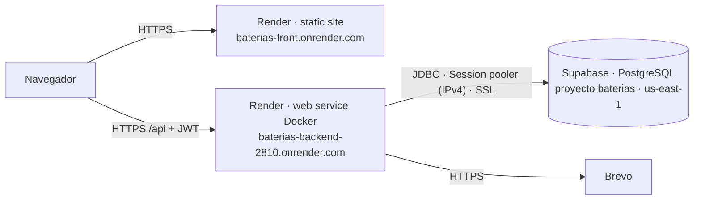

# Despliegue

Producción corre en servicios con plan gratuito: **Render** para el backend y el front, y **Supabase** para la base de datos.



| Pieza | Servicio | Plan | Región |
|---|---|---|---|
| Backend | Render, *web service* con el `Dockerfile` | Free | Virginia (us-east) |
| Front | Render, *static site* | Free | — |
| Base de datos | Supabase (PostgreSQL) | Free | us-east-1 |
| Correo | Brevo (API) | Free | — |

El backend y la base están en la misma región de EE. UU. para bajar la latencia entre ellos.

## Ramas

**Render despliega la rama `despliegue`, no `main`**, en los dos repos. Se trabaja en `main` y, cuando se quiere publicar:

```bash
git branch -f despliegue main && git push origin despliegue
```

Si se cambiaron los dos repos, se hace en el backend y en el front.

- Un push a `main` no despliega nada. Se puede subir documentación o trabajo en curso sin afectar producción.
- Cada push a `despliegue` reconstruye la imagen y reinicia el backend. En el plan Free son unos **2–3 minutos sin servicio**. Por eso no se despliega solo por cambios de documentación.

## Backend en Render

### Imagen

El `Dockerfile` construye en dos etapas:

1. **Build** con `maven:3.9.9-eclipse-temurin-17`: `mvn package -DskipTests`. Los tests no corren en Render; hay que correrlos en local antes de desplegar.
2. **Ejecución** con `eclipse-temurin:17-jre`, con un usuario sin privilegios (`app`) y:
   - `SPRING_PROFILES_ACTIVE=prod`;
   - `TZ=America/Bogota` y `-Duser.timezone=America/Bogota`, porque Render corre en UTC y sin esto "hoy" y las fechas de auditoría saldrían corridas;
   - `-XX:MaxRAMPercentage=75`, para que la JVM respete la memoria del contenedor.

El `pom.xml` necesita `spring-boot-maven-plugin`: sin él, el jar no es ejecutable. Docker no está instalado en el equipo de desarrollo, así que **el build se valida en Render**. Para probar el perfil `prod` en local sin Docker:

```bash
./mvnw package -DskipTests
SPRING_PROFILES_ACTIVE=prod PORT=8081 java -jar target/*.jar     # desde la raíz: usa el .env
```

Ojo: con el `.env` local, esto se conecta a la base de **producción**.

### Perfil `prod` (`application-prod.properties`)

| Propiedad | Por qué |
|---|---|
| `server.forward-headers-strategy=native` | Render pone un proxy delante. Sin esto, la IP del cliente sería la del proxy, lo que dañaría el freno de intentos por IP y el registro de ingresos, y las URL saldrían con `http` |
| `spring.datasource.hikari.maximum-pool-size=5` | El pooler de Supabase Free limita las conexiones |
| `springdoc.*.enabled=false` | Swagger apagado (404) |

Los logs van **solo a consola** (`logback-spring.xml`): el disco del contenedor se pierde al reiniciar y Render guarda la salida. Se ven en el panel del servicio, pestaña *Logs*.

Render pasa el puerto en `PORT`, que `application.properties` toma como `server.port=${PORT:8080}`.

### Secret File `.env`

Los secretos viven en un **Secret File** del servicio del backend, llamado `.env`. Render lo monta en `/etc/secrets/.env` y `application.properties` lo importa (`spring.config.import=...,optional:file:/etc/secrets/.env[.properties]`).

**Contenido**: es el `.env` local, que ya tiene los valores de producción, **más `APP_FRONT_URL`**, que en local va vacío.

| Variable | Valor en producción |
|---|---|
| `BD_URL`, `BD_USUARIO`, `BD_CONTRASENA` | Conexión al Session pooler de Supabase (ver abajo) |
| `APP_SEGURIDAD_JWT_SECRETO` | Cadena aleatoria de 32 caracteres o más (`openssl rand -base64 48`) |
| `APP_CORS_ORIGENES` | `https://baterias-front.onrender.com` |
| `APP_SEGURIDAD_ADMIN_CORREO` / `_CONTRASENA` | Solo para una base vacía; después, vacías |
| `BREVO_API_KEY`, `APP_CORREO_REMITENTE`, `APP_CORREO_NOMBRE` | Ver `docs/correo.md` |
| `APP_FRONT_URL` | `https://baterias-front.onrender.com` |

> **Render no guarda historial de los Secret Files.** Si se borra o se sobrescribe, no hay forma de recuperarlo desde Render: se rehace con el `.env` local más `APP_FRONT_URL`. El `.env` local es, en la práctica, el respaldo de los secretos de producción. Pasó el 2026-11-11.

Notas:
- Las claves del `.env` **no tienen *relaxed binding***: `APP_SEGURIDAD_ADMIN_CORREO` no se convierte sola en `app.seguridad.admin.correo`. Por eso `application.properties` declara cada propiedad con su `${VARIABLE}`. Una variable nueva del `.env` también necesita su línea ahí.
- Si cambia `APP_SEGURIDAD_JWT_SECRETO`, todas las sesiones abiertas quedan inválidas y los usuarios vuelven a ingresar. No se pierde nada más.

### Arranque y plan Free

- El arranque tarda **≈ 2,5 minutos** (≈ 157 s medidos): la CPU del plan Free es limitada.
- **El servicio se duerme tras 15 minutos sin peticiones.** La siguiente petición lo despierta y espera todo el arranque. El front muestra "sin conexión" mientras tanto.
- Para uso real con usuarios, conviene el plan **Starter**, que no se duerme y tiene más CPU, o mantenerlo despierto con una petición periódica. **Está por decidir.**

## Base de datos en Supabase

- **Proyecto** `baterias`, región us-east-1.
- **Conexión por el *Session pooler***, no la conexión directa: la directa es solo IPv6 y Render no la alcanza. Formato de `BD_URL`:
  ```
  jdbc:postgresql://<host-del-pooler>:5432/postgres?sslmode=require
  ```
  El usuario del pooler tiene la forma `postgres.<ref-del-proyecto>`. Los datos se copian del panel de Supabase: *Connect → Session pooler*.
- **Data API apagada.** Las tablas no tienen RLS (*row level security*), así que la API REST automática de Supabase no debe estar encendida: dejaría las tablas expuestas. Solo el backend accede a la base.
- **Zona horaria**: el pooler no pasa la zona del JVM a la sesión de PostgreSQL, así que Hikari ejecuta `SET TIME ZONE 'America/Bogota'` al conectar (`spring.datasource.hikari.connection-init-sql`). Sin esto, `DEFAULT CURRENT_TIMESTAMP` guardaría la hora en UTC.

### Migraciones en producción

**Flyway corre al arrancar el backend.** No hay un paso aparte: al desplegar una versión con una migración nueva, esta se aplica en Supabase en el primer arranque.

- Si la migración falla, **el backend no arranca**. Hay que corregirla con una migración nueva, nunca editando una ya aplicada, y volver a desplegar.
- Antes de desplegar una migración, conviene probarla en la base local y, si toca datos, sobre una copia.
- Una base vacía queda lista con V1–V16 más el primer administrador (ver `README.md`).

### Respaldos

El plan Free de Supabase no ofrece restauración a un punto en el tiempo. Para un respaldo manual:

```bash
pg_dump -F c -h <host-del-pooler> -U postgres.<ref> -d postgres -f bateria_prod_AAAA-MM-DD.dump
```

El `pg_dump` local debe ser de una versión igual o mayor que la del servidor. **El `.dump` tiene datos personales de los trabajadores: nunca va a git** (el `.gitignore` y el `.dockerignore` excluyen `*.dump`). Se guarda fuera del repo.

## Front en Render

Es un *static site* desde la rama `despliegue` del repo `baterias_front`. El detalle está en el `CLAUDE.md` de ese repo. En resumen:

- **Build**: `npx --yes pnpm@<versión> install --frozen-lockfile && npx --yes pnpm@<versión> run build`. `corepack enable` falla en Render porque su `/usr/bin` es de solo lectura.
- **Publish**: `dist/baterias_front/browser`.
- **Regla *Rewrite*** `/*` → `/index.html`, para que las rutas de Angular, como `/definir-contrasena`, funcionen al recargar o al abrirlas desde un correo.
- `src/environments/environment.ts` tiene la URL del backend (`https://baterias-backend-2810.onrender.com/api`).
- La URL del front debe estar en `APP_CORS_ORIGENES` del backend.

## Lista para desplegar

1. `./mvnw test` en verde.
2. Si hay migración nueva: probada en local.
3. Si hay variables nuevas: agregadas al `.env.example`, a `application.properties` y al **Secret File de Render**, antes de desplegar.
4. `git branch -f despliegue main && git push origin despliegue`, en el backend y, si cambió, en el front.
5. En los *Logs* de Render, revisar que:
   - Flyway aplicó las migraciones (`Successfully applied N migrations` o `Schema ... is up to date`).
   - Aparece `Started RiesgoPsicosocialApiApplication`.
   - **No** aparece `Falta APP_FRONT_URL` ni `Hay clave de Brevo pero falta APP_CORREO_REMITENTE`.
6. Ingresar en `https://baterias-front.onrender.com` y probar lo que cambió.

## Problemas conocidos

| Síntoma | Causa | Solución |
|---|---|---|
| El backend no arranca y el log dice `FATAL: (ENOTFOUND) tenant/user postgres.<ref> not found` | **Supabase pausa los proyectos Free tras 7 días sin actividad** | En el panel de Supabase: *Restore project*. Cuando esté activo, *Manual Deploy* en Render. Cómo evitarlo (actividad periódica o plan pago) está por decidir |
| El front muestra "sin conexión" el primer rato | El backend estaba dormido (plan Free) | Esperar ≈ 2,5 min. Ver *Arranque y plan Free* |
| Al arrancar sale `Falta APP_FRONT_URL`, o los enlaces de los correos no llevan al front | Falta `APP_FRONT_URL` en el Secret File **del backend** (no va en el static site) | Agregarla al Secret File y redesplegar |
| Los enlaces de contraseña salen en el log y no llegan por correo | Faltan las variables de Brevo: el backend queda en modo log sin avisar | Revisar `BREVO_API_KEY` y `APP_CORREO_REMITENTE` en el Secret File. Ver `docs/correo.md` |
| Brevo responde 401 en el log | La clave de API no es válida o se revocó | Generar otra (`xkeysib-…`) en Brevo y ponerla en el `.env` local y en el Secret File |
| Se borró el Secret File | — | Rehacerlo con el `.env` local más `APP_FRONT_URL` y redesplegar |
| Fechas o "hoy" corridos 5 horas | Falta la zona horaria en el JVM o en la sesión de PostgreSQL | Revisar `TZ`/`-Duser.timezone` en el `Dockerfile` y `connection-init-sql` en `application.properties` |
| Error de CORS en el navegador | La URL del front no está en `APP_CORS_ORIGENES` | Agregarla (sin `/` al final) y redesplegar |
| El backend no arranca tras una migración nueva | La migración falló en Supabase | Ver el error de Flyway en el log, corregir con una migración nueva y redesplegar. Nunca editar una migración aplicada |
