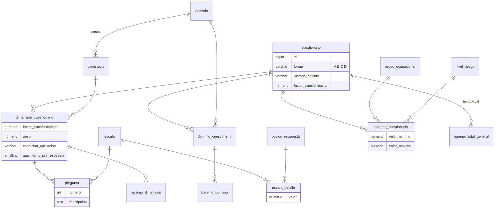
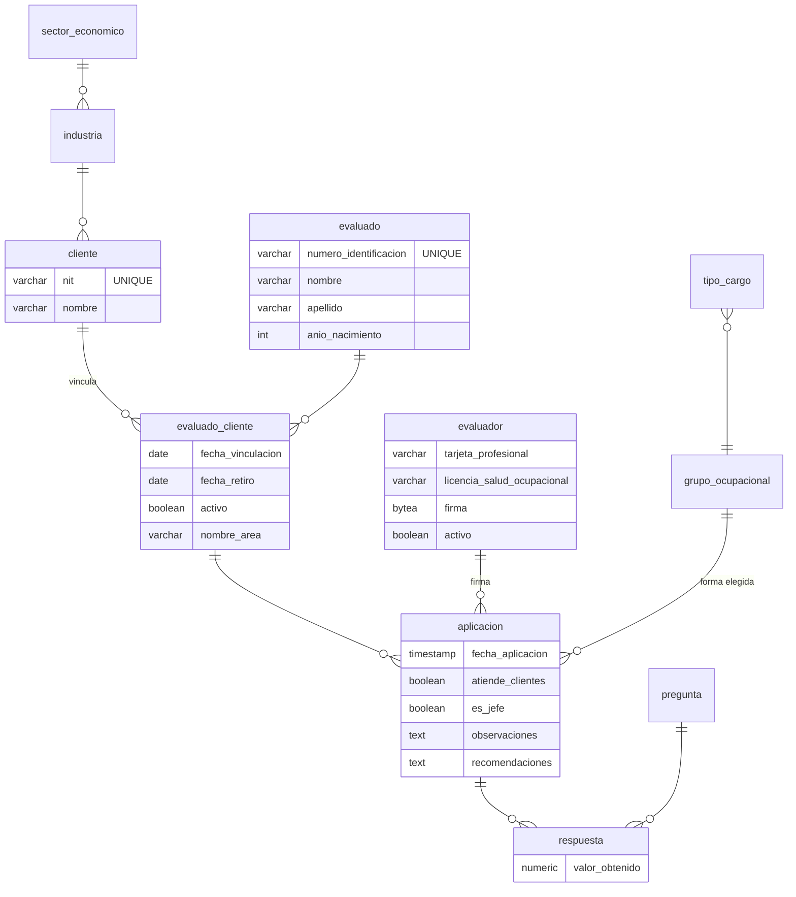
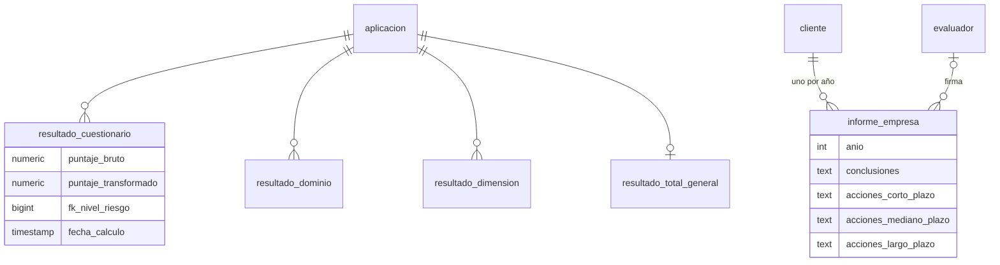
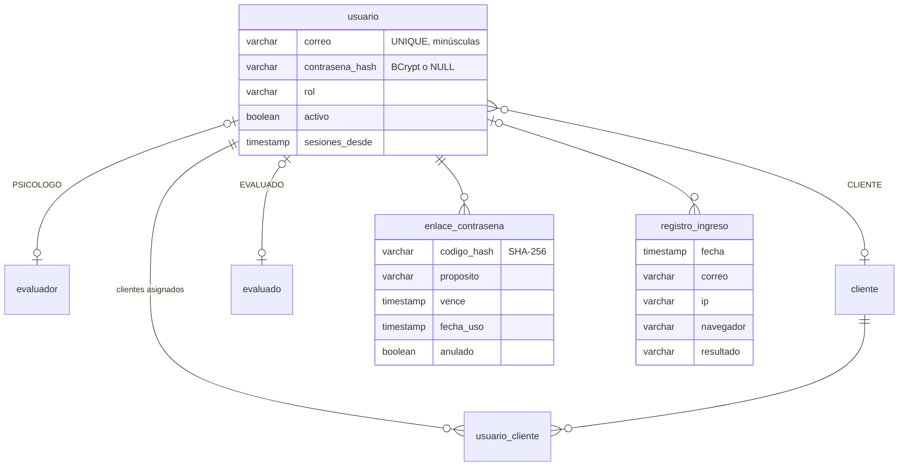

# Modelo de datos

Base PostgreSQL de 43 tablas, manejada con Flyway (`src/main/resources/db/migration`). Se agrupan en cuatro áreas:

1. **Estructura de la batería**: cuestionarios, dominios, dimensiones, preguntas, escalas y baremos. Son datos maestros fijos que salen de los manuales.
2. **Empresas, personas y aplicaciones**: clientes, trabajadores, su vínculo con cada empresa, las aplicaciones de la batería y sus respuestas.
3. **Resultados e informes**: puntajes y niveles calculados, y las conclusiones del informe de empresa.
4. **Usuarios y seguridad**: usuarios, clientes asignados, enlaces de contraseña y registro de ingresos.

A eso se suman los **catálogos** de la ficha de datos generales, más la historia de Flyway (`flyway_schema_history`).

## Convenciones

- **Llaves**: `id BIGINT` autogenerado. Las foráneas se llaman `fk_<tabla>` y, cuando el nombre no basta, `fk_<rol>`, por ejemplo `fk_ciudad_trabajo` o `fk_cuestionario_intralaboral`.
- **Nombres** en `snake_case` y en español. En Java se mapean a `camelCase` con `@Column`.
- **Auditoría** en las tablas de negocio: `usuario_crea`, `fecha_creado` (`DEFAULT CURRENT_TIMESTAMP`), `usuario_modifica` y `fecha_modificado`. Las llena cada servicio; ver `docs/arquitectura.md`. Los diagramas de abajo las omiten.
- **Sin borrado**: las tablas de negocio no tienen `DELETE`. Los registros se inactivan (`activo`, `fecha_retiro`). La excepción son los resultados, que se reemplazan al recalcular.
- **Enumeraciones** como `VARCHAR` con `CHECK` (por ejemplo `metodo_calculo` o `rol`), mapeadas a `enum` en Java con `@Enumerated(STRING)`.
- **Fechas** en `TIMESTAMP` sin zona, siempre en hora de Colombia (ver la sección de zona horaria en `docs/arquitectura.md`).

## 1. Estructura de la batería

| Tabla | Qué guarda |
|---|---|
| `cuestionario` | Los cuatro instrumentos: **A** y **B** intralaboral, **C** extralaboral y **D** estrés. `metodo_calculo` dice cómo se califica (`SUMA_POR_DOMINIOS` en A y B, `SUMA_DIRECTA` en C, `PROMEDIO_PONDERADO` en D) y `factor_transformacion` es el divisor del puntaje total (492, 388, 124 y 61,16). **El código distingue los cuestionarios por `metodo_calculo`, nunca por la letra** |
| `dominio`, `dimension` | El catálogo de dominios y dimensiones del manual. Una dimensión pertenece a un dominio |
| `dominio_cuestionario`, `dimension_cuestionario` | Qué dominios y dimensiones tiene cada cuestionario, con su factor de transformación. `dimension_cuestionario` lleva además el `peso` (solo en D: 4/3/2/1), la `condicion_aplicacion` (`ATIENDE_CLIENTES` o `ES_JEFE`: la dimensión solo aplica si la pregunta filtro es "sí") y `max_items_sin_respuesta` (la tolerancia del manual) |
| `pregunta` | Cada ítem, con su número dentro del cuestionario, la dimensión a la que suma y su escala |
| `escala`, `escala_detalle`, `opcion_respuesta` | `opcion_respuesta` son las cinco opciones (Siempre … Nunca). Cada `escala` define cuánto vale cada opción; hay escalas directas e invertidas. El puntaje de una respuesta sale de `escala_detalle` |
| `grupo_ocupacional` | 1 = jefes, profesionales y técnicos (forma A); 2 = auxiliares y operarios (forma B) |
| `nivel_riesgo` | Los cinco niveles: 1 sin riesgo o riesgo despreciable … 5 riesgo muy alto. En estrés se muestran como Muy bajo … Muy alto |
| `baremo_cuestionario`, `baremo_dominio`, `baremo_dimension` | Rangos del puntaje transformado → nivel de riesgo, **por grupo ocupacional**. Los cuestionarios que se le aplican a un grupo son los que tienen baremos para él |
| `baremo_total_general` | Tabla 34 del manual: el nivel del puntaje total intralaboral + extralaboral, según la forma intralaboral (A o B) |

Todo esto llega por migración (V1–V9 y V16) y está verificado contra los manuales. **No se modifica desde la aplicación**: si un dato maestro cambia, va en una migración nueva.

Particularidades:
- En C y D el dominio solo agrupa: no tiene baremos y no se califica.
- D se califica solo en total: el manual no trae baremos por dimensión de estrés.

El cálculo se explica en `docs/motor-de-calculo.md`.

## 2. Empresas, personas y aplicaciones

| Tabla | Qué guarda |
|---|---|
| `cliente` | La empresa evaluada: NIT, nombre, industria, ciudad y datos de contacto. El NIT es único (V24, `uk_cliente_nit`; se guarda sin espacios a los lados) y no cambia después de creado (lo valida el servicio) |
| `evaluado` | **La persona**: solo lo que no cambia (documento único, nombre, apellido, sexo, año de nacimiento) |
| `evaluado_cliente` | **La relación persona–empresa** y la foto de los datos que sí cambian (ver abajo) |
| `aplicacion` | Una aplicación de la batería a una persona en una empresa. Guarda la forma elegida (`fk_grupo_ocupacional`), las preguntas filtro (`atiende_clientes`, `es_jefe`; `NULL` = sin registrar), el evaluador que firma y las observaciones y recomendaciones del informe individual |
| `respuesta` | Una por pregunta y aplicación (UNIQUE). `valor_obtenido` lo calcula el backend con la escala de la pregunta; el cliente nunca lo envía |
| `evaluador` | El psicólogo que firma los informes: identificación, tarjeta profesional, licencia en salud ocupacional y la **firma** como imagen (`BYTEA` + `firma_tipo_contenido`) |

### Persona vs. relación (V17)

Una persona puede trabajar en varias empresas a lo largo del tiempo, y la evaluación debe reflejar sus datos **al momento de evaluarla**. Por eso:

- `evaluado` tiene solo los datos fijos.
- `evaluado_cliente` guarda, por cada vinculación, los **datos laborales** (cargo, tipo de cargo, área, ciudad de trabajo, contrato, horas, salario, antigüedad) y los **datos personales que cambian** (estado civil, nivel académico, residencia, estrato, vivienda, ocupación y dependientes).
- La vigencia la dan `fecha_vinculacion` (obligatoria) y `fecha_retiro`, que se llena al inactivar. Un `CHECK` impide que el retiro sea anterior a la vinculación.

Reglas que aplica el servicio:

- **Una sola relación activa por persona.** Si se vincula a otra empresa, la relación anterior se cierra.
- **Una relación cerrada no se edita**: conserva la foto con que se evaluó. Solo se puede reactivar, y únicamente si la persona no tiene otra relación activa.

Así, el informe de un año pasado no cambia aunque la persona se mueva después.

> `evaluado` todavía tiene las columnas viejas de los datos que pasaron a la relación (estado civil, nivel académico, etc.). Ya no se usan; se borrarán en una migración posterior.

### Forma y grupo ocupacional

La forma A o B la **elige el psicólogo** al crear la aplicación y queda guardada en `aplicacion.fk_grupo_ocupacional`, como foto. `tipo_cargo.fk_grupo_ocupacional` solo sirve para sugerirla y para avisar si no coincide.

### Estado de una aplicación

No se guarda: se calcula a partir de las respuestas y los resultados (`EstadoAplicacion`). Los estados son `SIN_RESPUESTAS`, `INCOMPLETA`, `PENDIENTE_CALCULO` y `CALCULADA`. Si se corrigen las respuestas, la forma o las preguntas filtro, los resultados se borran y la aplicación vuelve a quedar pendiente de cálculo.

## 3. Resultados e informes

| Tabla | Qué guarda |
|---|---|
| `resultado_cuestionario` | Puntaje bruto, transformado y nivel de cada cuestionario de la aplicación |
| `resultado_dominio` | Lo mismo por dominio (solo A y B) |
| `resultado_dimension` | Lo mismo por dimensión (A, B y C) |
| `resultado_total_general` | Total intralaboral + extralaboral, con el baremo de la Tabla 34 |
| `informe_empresa` | Conclusiones, acciones a corto, mediano y largo plazo, y firmante del informe de empresa. Una fila por cliente y año (UNIQUE) |

Cada resultado es UNIQUE por aplicación y elemento. **Recalcular reemplaza todo** en una transacción: nunca quedan resultados parciales. Si falta un baremo, el cálculo falla con 409.

El informe individual y el de empresa **no se guardan**: se arman al vuelo desde estas tablas cada vez que se piden. Lo mismo pasa con el nivel de riesgo de la empresa y la periodicidad. Solo se guarda lo que escribe el psicólogo: las observaciones y recomendaciones en `aplicacion`, y las conclusiones en `informe_empresa`.

## 4. Usuarios y seguridad

| Tabla | Qué guarda |
|---|---|
| `usuario` | Correo (el usuario de ingreso), nombre, rol, estado activo y contraseña en BCrypt. La contraseña es `NULL` mientras el usuario no la define por el enlace. `sesiones_desde` invalida los tokens emitidos antes de esa hora (cierra todas las sesiones) |
| `usuario_cliente` | Los clientes asignados a cada psicólogo |
| `enlace_contrasena` | Enlaces para definir la contraseña (`INVITACION` o `RESTABLECER`). **Solo se guarda el hash SHA-256 del código**: el código en claro va únicamente en el correo. Vence a las 48 h y es de un solo uso |
| `registro_ingreso` | Cada intento de ingreso: correo, usuario si existe, IP, navegador y resultado (`EXITOSO`, `FALLIDO`, `BLOQUEADO`). Nunca la contraseña. Se borra lo que tenga más de 12 meses |

Un `CHECK` en `usuario` amarra el rol con su vínculo:

| Rol | Vínculo |
|---|---|
| `ADMIN` | ninguno |
| `PSICOLOGO` | `fk_evaluador` (uno por evaluador, UNIQUE) + clientes en `usuario_cliente` |
| `CLIENTE` | `fk_cliente` |
| `EVALUADO` | `fk_evaluado` (previsto para responder en línea; aún no se usa) |

Otro `CHECK` exige el correo en minúsculas y con formato válido. Las reglas de acceso están en `docs/seguridad.md`.

## Catálogos

Son tablas `id` + `nombre`, cargadas por migración y en solo lectura desde la API: `sexo`, `estado_civil`, `nivel_academico`, `estrato_socioeconomico`, `tipo_vivienda`, `tipo_cargo` (con su grupo ocupacional), `tiempo_cargo`, `tipo_contrato`, `horas_labor`, `tipo_salario`, `sector_economico` → `industria`, y `departamento` → `ciudad_municipio` (con código DANE).

Corresponden a las opciones de la **ficha de datos generales** de la batería y a la división política de Colombia.

## Migraciones

| Versión | Cambio |
|---|---|
| V1 | Esquema inicial |
| V2 | Grupo ocupacional y método de cálculo |
| V3 | Escalas invertidas y dimensiones de la forma C |
| V4 | Baremos extralaboral y estrés |
| V5 | Sincronizar secuencias |
| V6 | Corrección de retroalimentación en A y B |
| V7 | Preguntas filtro en la aplicación |
| V8 | Condiciones y tolerancias por dimensión |
| V9 | Total general (Tabla 34) |
| V10 | Evaluador |
| V11 | Guion U+0096 en una dimensión |
| V12 | Errata "Bachillerato incompleto" |
| V13 | Conclusiones del informe de empresa |
| V14 | Comas que habían quedado como puntos en 13 preguntas |
| V15 | Usuarios y clientes asignados |
| V16 | **Datos maestros** completos e idempotentes (`ON CONFLICT DO NOTHING`): una base vacía queda lista con V1–V16 |
| V17 | Datos por relación y vigencia (persona vs. relación) |
| V18 | Nombres de departamentos sin guion bajo |
| V19 | Una respuesta por pregunta y aplicación |
| V20 | Ingreso con correo (`usuario.usuario` → `correo`) |
| V21 | Ajustes menores (se borra `aplicacion.estado`; "Más de un año") |
| V22 | Registro de ingresos |
| V23 | Enlaces de contraseña, contraseña opcional y `sesiones_desde` |
| V24 | NIT del cliente único (`uk_cliente_nit`) |

Reglas:
- **Nunca se edita una migración ya aplicada.** Flyway compara checksums y la app dejaría de arrancar.
- Si una migración inserta datos con id explícito, termina con `setval` sobre la secuencia.
- Un dato maestro que cambie va en una migración nueva, no en la V16.
