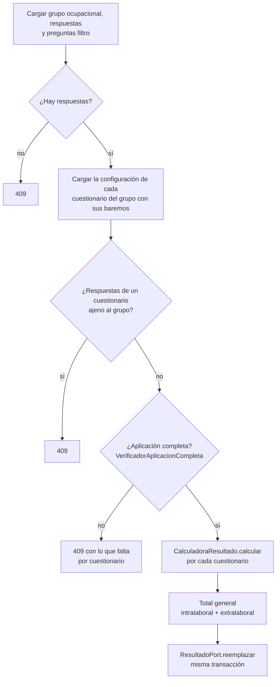

# Motor de cálculo

El motor convierte las respuestas de una aplicación en **puntajes y niveles de riesgo**, siguiendo los manuales de la Batería de Instrumentos para la Evaluación de Factores de Riesgo Psicosocial del Ministerio de Trabajo. Es la parte del sistema con más dominio y está implementada como hexágono (ver `docs/arquitectura.md`). La configuración que usa (estructura de los cuestionarios, escalas y baremos) está descrita en `docs/modelo-de-datos.md`.

## Los cuatro cuestionarios

| Forma | Cuestionario | Preguntas | Dimensiones | Método | Factor del total |
|---|---|---|---|---|---|
| A | Intralaboral (jefes, profesionales y técnicos) | 123 | 19 | `SUMA_POR_DOMINIOS` | 492 |
| B | Intralaboral (auxiliares y operarios) | 97 | 16 | `SUMA_POR_DOMINIOS` | 388 |
| C | Extralaboral | 31 | 7 | `SUMA_DIRECTA` | 124 |
| D | Síntomas de estrés | 31 | 4 | `PROMEDIO_PONDERADO` | 61,16 |

A cada aplicación le corresponden **tres cuestionarios**: A o B, según la forma que elige el psicólogo, más C y D. C y D son iguales para todos; lo que cambia según el grupo ocupacional es el **baremo** con que se califican. Los cuestionarios de un grupo son los que tienen baremos para él (`DatosCalculoPort.buscarCuestionariosDelGrupo`).

> El código distingue los cuestionarios por `metodo_calculo`, **nunca por la letra**. Por ejemplo, el total general busca "el de `SUMA_POR_DOMINIOS`" y "el de `SUMA_DIRECTA`".

## Del formulario a la respuesta

1. El psicólogo digita las respuestas en `PUT /aplicaciones/{id}/respuestas/{idCuestionario}` (`RespuestasAplicacionService`). Cada respuesta es la **opción** elegida: Siempre, Casi siempre, Algunas veces, Casi nunca o Nunca.
2. El backend calcula `respuesta.valor_obtenido` con la **escala de la pregunta** (`escala_detalle`). Si la opción no pertenece a esa escala, responde 400.

| Escala | Siempre | Casi siempre | Algunas veces | Casi nunca | Nunca | Uso |
|---|---|---|---|---|---|---|
| Directa | 0 | 1 | 2 | 3 | 4 | A, B y C |
| Invertida | 4 | 3 | 2 | 1 | 0 | A, B y C |
| Estrés grupo uno | 9 | 6 | 3 | — | 0 | D |
| Estrés grupo dos | 6 | 4 | 2 | — | 0 | D |
| Estrés grupo tres | 3 | 2 | 1 | — | 0 | D |

Qué pregunta usa la escala directa y cuál la invertida sale del manual y quedó corregido en la V3 y la V6. D tiene solo cuatro opciones.

## Flujo del cálculo

`POST /aplicaciones/{id}/resultados` → `ResultadoAplicacionService.calcular`:



- **Solo se calcula una aplicación completa**: todas las preguntas que aplican, de todos los cuestionarios del grupo. Es más estricto que el manual (ver *Tolerancia* abajo) y es una decisión a propósito: un cálculo con faltantes podría tomarse como definitivo y quedarse así.
- **Es recalculable.** Recalcular reemplaza todos los resultados anteriores en la misma transacción.
- **Nunca hay resultados parciales.** Si cualquier paso falla, por ejemplo porque falta un baremo o porque un puntaje no cae en ningún rango, no se guarda nada y se responde 409 con la causa.
- **Corregir invalida.** Si después se cambian las respuestas, la forma o las preguntas filtro, los resultados se borran (`BorradoResultados`) y la aplicación queda *pendiente de cálculo*.
- `GET /aplicaciones/{id}/resultados` consulta lo guardado sin recalcular.

## Reglas comunes

### Puntaje transformado

```
transformado = bruto × 100 / factor      redondeado a 1 decimal, HALF_UP
```

`CalculadoraResultado.transformar` es pública: el informe de empresa la usa para el nivel de riesgo de la empresa. El puntaje bruto se guarda con 2 decimales.

### Baremos

Un baremo es una lista de rangos `[valor_minimo, valor_maximo]`, **ambos inclusivos**, que llevan el puntaje transformado a un nivel de riesgo del 1 al 5. Los rangos del manual van de décima en décima (por ejemplo 0,0–19,7 y 19,8–25,8), por eso el transformado se redondea a un decimal antes de buscar el nivel. Si el puntaje no cae en ningún rango, o no hay baremo para el grupo, el cálculo falla con 409.

Ejemplo, el total de la forma A (grupo 1):

| Nivel | Rango |
|---|---|
| Sin riesgo o riesgo despreciable | 0,0 – 19,7 |
| Riesgo bajo | 19,8 – 25,8 |
| Riesgo medio | 25,9 – 31,5 |
| Riesgo alto | 31,6 – 38,0 |
| Riesgo muy alto | 38,1 – 100 |

En estrés (D) los mismos niveles se muestran como Muy bajo, Bajo, Medio, Alto y Muy alto (`NivelEstres`), con el título "Nivel de síntomas de estrés".

### Preguntas filtro

La aplicación guarda dos respuestas: `atiende_clientes` y `es_jefe`. Cada una puede ser sí, no o sin registrar (`NULL`). De ellas dependen dos dimensiones:

| Dimensión | Cuestionario | Condición |
|---|---|---|
| Demandas emocionales | A y B | `ATIENDE_CLIENTES` |
| Relación con los colaboradores | A | `ES_JEFE` |

- **"No" explícito** (`false`): la dimensión no aplica. Su puntaje bruto es **0**, no debe traer respuestas y no cuenta como faltante.
- **Sí o sin registrar**: la dimensión aplica y hay que responderla. Sin registrar se trata como "sí", para no dejar de calificar algo por omisión.

### Tolerancia de ítems sin respuesta

El manual permite dejar **1 ítem sin responder** en cuatro dimensiones de A y B: características del liderazgo, relaciones sociales en el trabajo, relación con los colaboradores (solo A) y demandas ambientales y de esfuerzo físico. Está configurado en `dimension_cuestionario.max_items_sin_respuesta` y `CalculadoraResultado` lo respeta. Sin embargo, como `VerificadorAplicacionCompleta` exige la aplicación completa, **en la práctica la tolerancia no se alcanza**. Se dejó en la calculadora para que siga fiel al manual por si la regla cambia.

## Métodos de cálculo

### `SUMA_POR_DOMINIOS` — formas A y B

```
bruto dimensión  = Σ valores de sus preguntas            (0 si no aplica)
bruto dominio    = Σ brutos de sus dimensiones
bruto total      = Σ brutos de todas las dimensiones
```

Cada nivel se transforma con su propio factor (`dimension_cuestionario`, `dominio_cuestionario` y `cuestionario`) y se califica con su baremo del grupo ocupacional. Guarda **dimensiones, dominios y total**. Toda dimensión debe pertenecer a un dominio del cuestionario; si no, es un error de configuración.

### `SUMA_DIRECTA` — forma C

```
bruto dimensión = Σ valores de sus preguntas
bruto total     = Σ brutos de las dimensiones
```

Guarda **dimensiones y total**. El dominio solo agrupa: no se califica.

### `PROMEDIO_PONDERADO` — forma D

```
bruto total = Σ ( promedio de los ítems de la dimensión × peso )
```

| Dimensión (grupo de síntomas) | Ítems | Peso |
|---|---|---|
| Síntomas fisiológicos | 8 | 4 |
| Síntomas de comportamiento social | 4 | 3 |
| Síntomas intelectuales y laborales | 10 | 2 |
| Síntomas psicoemocionales | 9 | 1 |

Guarda **solo el total**: el manual no trae baremos por dimensión de estrés. El promedio divide por los ítems respondidos, así que una dimensión de D no puede tener condición ni tolerancia. Si se configurara así, el cálculo falla por configuración inválida. El factor de transformación de las dimensiones de D no se usa.

## Total general

```
bruto     = bruto intralaboral (A o B) + bruto extralaboral (C)
factor    = 492 + 124 = 616   (A + C)
            388 + 124 = 512   (B + C)
nivel     = baremo_total_general (Tabla 34 del manual), según la forma intralaboral
```

D no entra en el total general. Se guarda en `resultado_total_general`.

## Lo que guarda

| Tabla | A / B | C | D |
|---|---|---|---|
| `resultado_cuestionario` (total) | ✓ | ✓ | ✓ |
| `resultado_dominio` | ✓ | | |
| `resultado_dimension` | ✓ | ✓ | |
| `resultado_total_general` | ✓ (A+C o B+C) | | |

Cada fila guarda el puntaje bruto, el transformado, el nivel de riesgo y la fecha de cálculo.

## Errores (todos 409, salvo que se indique)

| Situación | Mensaje (resumen) |
|---|---|
| La aplicación no existe | 404 |
| Sin respuestas | "no tiene respuestas registradas" |
| Respuestas de un cuestionario que no es del grupo (p. ej. quedaron de antes de cambiar la forma) | "tiene respuestas de cuestionarios que no son de su grupo ocupacional" |
| Aplicación incompleta | "La aplicación está incompleta: faltan N preguntas del cuestionario A y M del C…" |
| Dimensión que no aplica pero trae respuestas | "'Demandas emocionales' no aplica (ATIENDE_CLIENTES = no) pero tiene N respuestas" |
| Falta un baremo o el puntaje no cae en ningún rango | "No hay baremo para…" / "no cae en ningún rango del baremo…" |
| Configuración inválida (dimensión sin dominio en A/B, sin peso en D, etc.) | "Configuración incompleta/inválida del cuestionario…" |

## Dónde está el código

| Pieza | Clase |
|---|---|
| Caso de uso | `application/port/in/resultado/CalcularResultadosUseCase`, `ConsultarResultadosUseCase` |
| Orquestación | `application/service/resultado/ResultadoAplicacionService` |
| Cálculo (dominio puro) | `domain/service/resultado/CalculadoraResultado` |
| Aplicación completa | `domain/service/resultado/VerificadorAplicacionCompleta` |
| Configuración | `domain/model/resultado/configuracion/` (`ConfiguracionCuestionario`, `ConfiguracionDimension`, `RangoBaremo`, `FiltrosAplicacion`, `MetodoCalculo`…) |
| Lectura de datos | `infrastructure/adapter/out/persistence/resultado/DatosCalculoPersistenceAdapter` (+ `CatalogoCalculoLoader`) |
| Guardado | `infrastructure/adapter/out/persistence/resultado/ResultadoPersistenceAdapter` |
| Borrado al corregir | `infrastructure/adapter/out/persistence/resultado/BorradoResultados` |
| Valor de cada respuesta | `infrastructure/adapter/out/persistence/respuesta/RespuestasAplicacionService` |
| Estado de la aplicación | `EstadoAplicacion` (`SIN_RESPUESTAS`, `INCOMPLETA`, `PENDIENTE_CALCULO`, `CALCULADA`) |

**Tests**: `CalculadoraResultadoTest` y `VerificadorAplicacionCompletaTest` (dominio, sin base de datos) y `ResultadoAplicacionServiceTest` (orquestación con fakes de los puertos). Cualquier cambio en el cálculo debe venir con un caso de prueba, idealmente con los valores de un ejemplo verificado a mano contra el manual.
