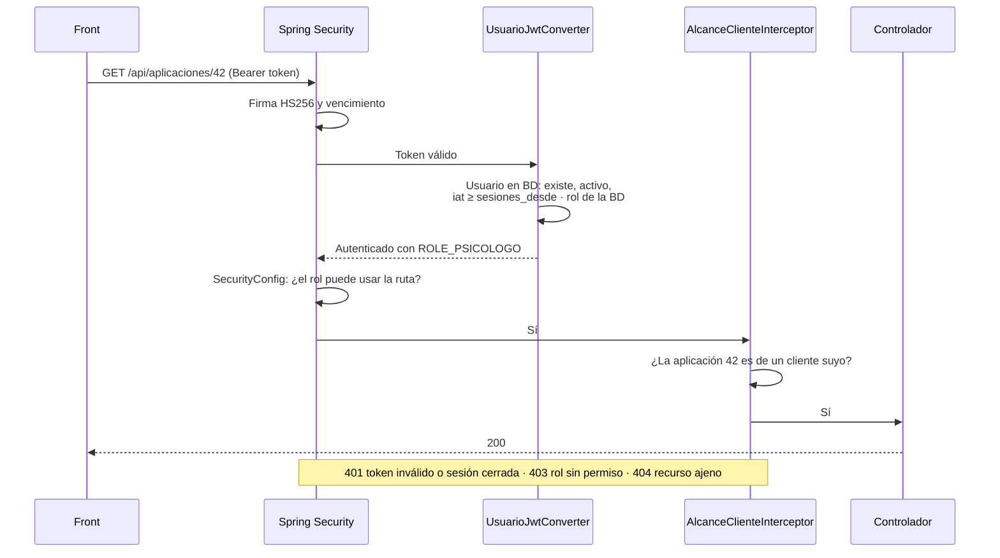
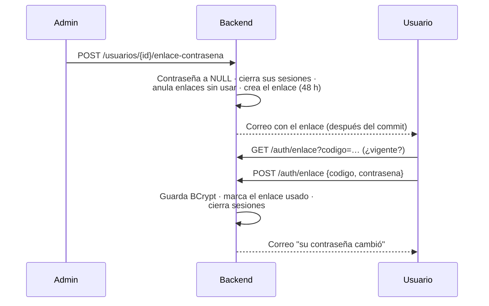

# Seguridad

La API no guarda sesión en el servidor: cada petición trae un **JWT** en `Authorization: Bearer …`. Cada petición protegida pasa por cuatro controles, en este orden:

1. **Token válido**: firma, vencimiento y sesión no cerrada.
2. **Usuario vigente**: existe en la BD y está activo.
3. **Rol con permiso** sobre la ruta.
4. **Alcance**: el recurso pertenece a un cliente que el usuario puede ver.

Todo está en `infrastructure/security`.

## Roles

| Rol | Quién es | Vínculo en `usuario` |
|---|---|---|
| `ADMIN` | Administra usuarios, clientes, evaluadores y configuración. **No ve informes ni datos de trabajadores** | ninguno |
| `PSICOLOGO` | Hace el trabajo: personas, aplicaciones, cálculo e informes de sus clientes asignados | `fk_evaluador` + clientes en `usuario_cliente` |
| `CLIENTE` | La empresa: solo ve su informe de empresa | `fk_cliente` |
| `EVALUADO` | Previsto para que el trabajador responda en línea. **Hoy no tiene acceso a nada** | `fk_evaluado` |

Un `CHECK` en la BD amarra cada rol con su vínculo (ver `docs/modelo-de-datos.md`).

## Inicio de sesión y token

- `POST /auth/login` recibe `{correo, contrasena}`. El correo se normaliza (trim y minúsculas). Si es correcto, devuelve un token de **8 h** (`app.seguridad.jwt.duracion`).
- El token es un JWT **HS256** firmado con `APP_SEGURIDAD_JWT_SECRETO`, que debe tener al menos 32 bytes; sin él, la app no arranca fuera del perfil `dev`. Lleva el id del usuario en `sub` y, solo como información para el front, el correo, el nombre y el rol.
- **Los permisos no salen del token.** `UsuarioJwtConverter` lee el usuario de la BD en cada petición y toma de ahí el rol y el estado activo. Si al usuario se le cambia el rol o se inactiva, el cambio aplica en la siguiente petición, sin esperar a que venza el token.
- **Cerrar todas las sesiones**: `usuario.sesiones_desde` guarda una hora, y todo token emitido antes (`iat` anterior) se rechaza con 401. Se usa al generar un enlace de contraseña, al definirla y al cambiarla.
- `GET /auth/yo` devuelve el usuario de la sesión.
- **Un login fallido no revela la causa.** El mensaje y el tiempo de respuesta son los mismos si el usuario no existe, está inactivo, aún no tiene contraseña o la contraseña no coincide. Cuando el usuario no existe, igual se compara contra un hash de relleno para que tarde lo mismo.
- Las contraseñas se guardan con **BCrypt** y tienen entre 8 y 72 caracteres (72 es el límite de BCrypt). Una contraseña escrita a mano en la BD no sirve.

### Freno a la fuerza bruta (`LimiteIntentosLogin`)

| Límite | Valor | Propiedad |
|---|---|---|
| Fallos seguidos por correo | 5 | `app.seguridad.login.max-intentos-usuario` |
| Fallos seguidos por IP | 20 | `app.seguridad.login.max-intentos-ip` |
| Bloqueo desde el último fallo | 15 min | `app.seguridad.login.bloqueo` |

- El bloqueo se revisa **antes** de consultar la BD y de comparar con BCrypt. Mientras dura, se responde **429** con `Retry-After`, aunque la contraseña sea la correcta.
- Un ingreso exitoso reinicia el contador del correo, pero **no el de la IP**, para que no se pueda limpiar el contador de una IP entrando con una cuenta propia.
- La contraseña actual en "Cambiar mi contraseña" suma al **mismo contador** del login.
- Los contadores viven **en memoria**: se pierden al reiniciar y sirven para una sola instancia. Si algún día hay varias instancias, habría que moverlos a la BD o a un almacén compartido.
- Detrás del proxy de Render, la IP real llega gracias a `server.forward-headers-strategy=native` en el perfil `prod`.

### Registro de ingresos (`RegistroIngresos`, tabla `registro_ingreso`)

- Cada intento de ingreso queda registrado con el correo normalizado, el usuario si existe, la IP, el navegador (`User-Agent`, máximo 255 caracteres) y el resultado: `EXITOSO`, `FALLIDO` o `BLOQUEADO`. Un bloqueo se registra solo en su **primer rechazo**, no en cada reintento.
- **Nunca se guarda la contraseña.**
- Si falla la escritura, el error queda en el log y el login sigue.
- **Retención de 12 meses** (`app.seguridad.ingresos.retencion`), porque la IP es un dato personal. Lo viejo se borra un minuto después de arrancar y luego una vez al día.
- **Consulta** (2026-11-25): `GET /registro-ingresos?desde=&hasta=` (`RegistroIngresoController` → `RegistroIngresoService`), **solo ADMIN** porque la IP es un dato personal. Fechas `yyyy-MM-dd`, los dos días incluidos; sin ellas, los últimos 30 días hasta hoy; `desde` posterior a `hasta` → 400. Devuelve los totales de exitosos, fallidos y bloqueados de todo el rango y las filas de la más reciente a la más antigua, con el nombre del usuario si el correo existe, con un tope de **2.000** (`truncado: true` y el mensaje lo avisan). Solo lectura y sin exportar. El front la muestra en Administración → Ingresos.

## Contraseñas por enlace

**El administrador nunca ve ni escribe contraseñas.** Cada usuario define la suya con un enlace que le llega por correo. No existe "¿Olvidó su contraseña?": quien la olvida llama por teléfono al administrador, y él le genera un enlace nuevo.

**Generar el enlace** (`EnlaceContrasenaService.generar`, en una transacción):
- La contraseña actual **deja de servir** (queda en `NULL`).
- Se cierran todas las sesiones del usuario.
- Se anulan sus enlaces anteriores sin usar.
- Se crea el enlace nuevo.

Solo puede hacerlo un ADMIN. Responde 409 si el usuario está inactivo o si el administrador intenta generarse un enlace a sí mismo.

**Propósito del enlace**: es `INVITACION` si el usuario nunca tuvo contraseña ni un enlace usado; si no, es `RESTABLECER`. Cambia el texto del correo.

**El código**:
- Son 32 bytes aleatorios en Base64 URL.
- **En la BD solo se guarda su SHA-256**; el código en claro existe únicamente en el correo.
- Vence a las **48 h** y es de **un solo uso**.
- Al usarlo, el enlace se lee con bloqueo `PESSIMISTIC_WRITE`, para que dos envíos simultáneos no lo usen dos veces.

**Endpoints públicos**, sin token:
- `GET /auth/enlace?codigo=` responde siempre 200, con `vigente` y un `estado`:
  - `VIGENTE`: además trae nombre, correo, propósito y vencimiento.
  - `VENCIDO`, `USADO` o `ANULADO`.
  - `INVALIDO`: el código no existe o el usuario está inactivo. No se dice cuál de los dos, para no revelar información.

  Si no está vigente, el mensaje remite al administrador por teléfono.
- `POST /auth/enlace` `{codigo, contrasena}` define la contraseña. Devuelve el correo, **no inicia sesión**, y responde 409 con el mensaje del estado si el enlace no sirve.

**Crear un usuario** (`UsuarioService.crearConInvitacion`): se crea sin contraseña y con la invitación en la misma transacción. Si se crea inactivo, no se envía nada; el enlace se genera cuando se active.

**Estado de la contraseña en el listado** (2026-11-25): `GET /usuarios` y los demás endpoints de `/usuarios` devuelven `estadoContrasena` en cada usuario, para que el administrador sepa a quién reenviarle el enlace sin preguntarle:
- `DEFINIDA`: ya tiene contraseña.
- `PENDIENTE`: no tiene contraseña y tiene un enlace sin usar, sin anular y sin vencer; `venceEnlace` dice hasta cuándo sirve.
- `SIN_ENLACE`: no tiene contraseña y su enlace venció, se anuló o nunca se generó (por ejemplo, porque se creó inactivo).

`EnlaceContrasenaService.estadosContrasena` lo calcula para todo el listado con una sola consulta (`vencimientosVigentes`), y solo para los usuarios sin contraseña. Nunca expone la contraseña, su hash ni el código del enlace.

**Primer administrador** (`PrimerAdministrador`): si la tabla `usuario` está vacía al arrancar, se crea con `APP_SEGURIDAD_ADMIN_CORREO` y `APP_SEGURIDAD_ADMIN_CONTRASENA`. Después esas variables se ignoran y conviene vaciarlas.

### Cambiar la propia contraseña

`PUT /auth/contrasena` `{actual, nueva}`, para cualquier rol:
- La actual cuenta para el freno del login (429).
- Responde 400 si la actual no coincide o si la nueva es igual a la actual.
- **Cierra todas las sesiones** y devuelve un **token nuevo**, para que la sesión actual siga abierta.
- Envía el correo "su contraseña cambió" (ver `docs/correo.md`).

## Permisos por rol (`SecurityConfig`)

Las reglas se evalúan en orden y **gana la primera que coincide**. Al final, **`anyRequest().denyAll()`**: una ruta que no esté clasificada queda bloqueada para todos, así un endpoint nuevo no queda abierto por olvido.

| Rutas | ADMIN | PSICOLOGO | CLIENTE |
|---|---|---|---|
| `POST /auth/login`, `GET`/`POST /auth/enlace`, Swagger | público | público | público |
| `/auth/**` (yo, cambiar contraseña) | ✓ | ✓ | ✓ |
| `/usuarios/**` | ✓ | | |
| `GET /registro-ingresos` | ✓ | | |
| Configuración de la batería (cuestionarios, preguntas, dominios, dimensiones, baremos, escalas…) | lectura y escritura | lectura | |
| Catálogos (departamentos, ciudades, sexos, tipos de cargo…) | lectura | lectura | |
| `GET /clientes`, `GET /clientes/{id}` | ✓ | ✓ (sus clientes) | |
| `POST`/`PUT /clientes` | ✓ | | |
| `/clientes/{id}/personas` (listar, vincular, plantilla, carga) | | ✓ | |
| `/clientes/{id}/evaluados/**` (informe individual) | | ✓ | |
| `GET /clientes/{id}/informe/**` (informe de empresa) | | ✓ | ✓ (su empresa) |
| `PUT /clientes/{id}/informe/conclusiones` | | ✓ | |
| `GET /evaluadores` (listado) | ✓ | | |
| `GET /evaluadores/{id}`, `/evaluadores/{id}/firma` | ✓ | solo el propio | |
| `PUT /evaluadores/{id}/firma` | ✓ | solo el propio | |
| `POST`/`PUT /evaluadores` | ✓ | | |
| `/evaluados/**`, `/evaluado-clientes/**`, `/aplicaciones/**`, `/respuestas/**` | | ✓ | |

`PermisosPorRolTest` (`@WebMvcTest`) recorre esta tabla. **Un endpoint nuevo se agrega en `SecurityConfig` y en ese test.**

Las respuestas 401 y 403 salen en formato `ApiError`, con `errorCode` `UNAUTHORIZED` o `FORBIDDEN` (`RespuestasSeguridad`).

## Alcance por cliente

El rol dice **qué tipo de ruta** puede usar un usuario; el alcance dice **qué datos** puede ver dentro de esa ruta. `AlcanceUsuario` calcula los clientes visibles de cada usuario:

| Rol | Clientes que ve |
|---|---|
| ADMIN | todos (pero sus permisos por rol no lo dejan entrar a datos de trabajadores) |
| PSICOLOGO | los asignados en `usuario_cliente` |
| CLIENTE | el suyo (`fk_cliente`) |
| EVALUADO | ninguno |

**Lo ajeno responde 404, con el mismo mensaje que si no existiera.** Así no se puede averiguar qué clientes, personas o aplicaciones hay probando ids.

Hay tres puntos de control:

1. **`AlcanceClienteInterceptor`**, antes del controlador, revisa los ids de la URL en `/clientes`, `/evaluado-clientes`, `/aplicaciones`, `/respuestas` y `/evaluados`. A partir de la plantilla de la ruta sabe a qué apunta cada id: un cliente, una relación, una aplicación, una respuesta o una persona. Una ruta nueva bajo esos prefijos queda cubierta sin hacer nada.
2. **Cada controlador** revisa lo que llega en el **cuerpo**, por ejemplo la relación al crear una aplicación, y filtra los **listados** con `clientesVisibles()`, `relacionesVisibles()` o `evaluadosVisibles()`.
3. **Reglas puntuales** en `AlcanceUsuario`:
   - **Personas** (`exigirEvaluado`): se ve si tiene relación con alguno de sus clientes, o si todavía no tiene ninguna, para poder vincularla. La búsqueda exacta por documento no se filtra, para saber si la persona ya existe antes de vincularla.
   - **Firmante** (`exigirFirmante`): en aplicaciones y conclusiones, el psicólogo solo puede ponerse a sí mismo. Se admite vacío o el firmante que ya tenía el registro. Cualquier otro responde 403.
   - **Evaluador y firma** (`exigirEvaluadorPropio`): solo el ADMIN o el propio psicólogo (403).

## Reglas para no quedarse sin administración

`UsuarioService.validarQueQuedeAdministracion` responde 409 si:
- un usuario intenta cambiarse el rol o inactivarse a sí mismo;
- el cambio dejaría al sistema sin ningún ADMIN activo.

## CORS (`CorsConfig`)

- Es la única configuración de CORS: ningún controlador declara `@CrossOrigin`.
- Los orígenes permitidos vienen de `APP_CORS_ORIGENES`, separados por coma, y admiten patrones (`https://*.dominio.com`). Sin valor, no se acepta ningún origen. El perfil `dev` acepta cualquier puerto de `localhost` y `127.0.0.1`.
- No usa credenciales, porque el token va en el encabezado `Authorization` y no en cookies. Por la misma razón no hay CSRF.
- Expone `Content-Disposition`, para que el front lea el nombre de los archivos descargados.
- Va antes de pedir el token, para que el *preflight* (`OPTIONS`) del navegador no reciba 401.

## Otras medidas

- **Swagger está apagado en producción** (404).
- **Secretos** solo por variables o por el `.env`, que no va a git (ver `README.md`). En `application.properties` solo hay referencias `${...}`.
- **Auditoría**: cada cambio guarda el correo de quien lo hizo (`UsuarioActual`; ver `docs/arquitectura.md`).
- **Datos personales**:
  - La plantilla de carga de personas siempre se descarga vacía: nunca se exportan personas ya cargadas.
  - Los informes protegen los grupos pequeños (ver `docs/informes.md`).
  - Con Brevo activo, el código de los enlaces no se escribe en el log. **En modo log sí se escribe**, porque ese modo existe para desarrollo; en producción hay que verificar que las variables de Brevo estén puestas (ver `docs/correo.md`).

## Dónde está el código

| Pieza | Clase |
|---|---|
| Reglas por rol | `SecurityConfig` |
| JWT (codificador, decodificador, secreto) | `JwtConfig`, `TokenService` |
| Token → usuario de la BD | `UsuarioJwtConverter`, `UsuarioAutenticado`, `UsuarioActual` |
| Login y cambio de contraseña | `AutenticacionService`, `AuthController` |
| Fuerza bruta e ingresos | `LimiteIntentosLogin`, `RegistroIngresos` |
| Alcance por cliente | `AlcanceUsuario`, `AlcanceClienteInterceptor`, `AlcanceWebConfig` |
| Respuestas 401/403 | `RespuestasSeguridad` |
| CORS | `CorsConfig` |
| Enlaces de contraseña | `persistence/usuario/EnlaceContrasenaService` |
| Usuarios y reglas de administración | `persistence/usuario/UsuarioService`, `persistence/usuario/PrimerAdministrador` |
